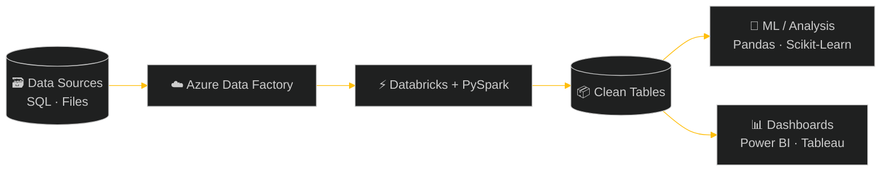

<div align="center">

<!-- ═══════════════ HEADER ═══════════════ -->


<br/>


<br/><br/>

<a href="https://sourabhbagda24.github.io/portfolio/"></a>
<a href="https://www.linkedin.com/in/sourabh-sharma-90758232b/"></a>
<a href="mailto:sourabhbagda9@gmail.com"></a>
<a href="https://github.com/sourabhbagda24"></a>
<a href="https://www.hackerrank.com/profile/sourabhbagda11"></a>

</div>


<!-- ═══════════════ BOOT ═══════════════ -->
<div align="center">

</div>

```ansi
┌─[sourabh@ai-forge]─[~/profile]
└──╼ $ ./ignite.sh

  [  OK  ] Loading neural modules ............ LangChain · HuggingFace · PyTorch
  [  OK  ] Mounting data layer ............... Pandas · SQL · PySpark · Databricks
  [  OK  ] Connecting cloud .................. Azure Data Factory · AWS · GCP
  [  OK  ] Arming security guard ............. OWASP LLM Top 10 · Red-Team Suite
  [  OK  ] Opening voice channel ............. Pipecat · WebRTC · Hinglish 🗣️
  [ LIVE ] Status ............................ OPEN TO WORK 🔥
```

[](#)

<!-- ═══════════════ ABOUT ═══════════════ -->
<div align="center">

</div>


```python
class SourabhSharma:

    name       = "Sourabh Sharma"
    alias      = "sourabhbagda24"
    location   = "Jaipur, Rajasthan 🇮🇳"
    role       = "Data Scientist · AI Developer & ML Engineer"
    current    = "Data Science Intern @ ReGex Software 🏢"
    education  = "B.Tech — VIT Jaipur"
    cert       = ["Kaggle Python ✅"]

    data_stack = [
        "Python · Pandas · NumPy 🐍",
        "SQL · MySQL · PostgreSQL 🗃️",
        "Azure Data Factory ☁️",
        "PySpark · Databricks ⚡",
        "Power BI · Tableau · Plotly 📊",
    ]

    ai_stack   = [
        "LangChain & LlamaIndex 🔗",
        "RAG Systems & Vector DBs 📦",
        "LLMs — GPT, Gemini, Ollama, Groq 🤖",
        "Agentic AI & Multi-Agent Systems 🕸️",
        "Hugging Face Transformers 🤗",
        "AI Security — OWASP LLM Top 10 🔐",
    ]

    passions   = [
        "Generative AI 🧬",
        "Data Engineering & Analytics 📊",
        "Trading Analytics 📈",
        "Startup & Automation 🚀",
        "NLP & Deep Learning 🧠",
        "Open Source Contribution 🌍",
    ]

    def life_motto(self):
        return "Build AI that thinks. Write code that ships. 🤖⚡"
```

<br clear="right"/>

[](#)

<!-- ═══════════════ HUD ═══════════════ -->
<div align="center">


<br/>


</div>

[](#)

<!-- ═══════════════ ACHIEVEMENTS ═══════════════ -->
<div align="center">

</div>

```text
╔══════════════════════════════════════════════════════════════════════╗
║  🏆  ACHIEVEMENTS UNLOCKED                                           ║
╠══════════════════════════════════════════════════════════════════════╣
║  🛡️  Red-Team Survivor ─── 19/20 attacks → 0/20 after the gateway    ║
║  🧪  Mutation Master ───── 46 defences tested, all 46 caught         ║
║  🗣️  Voice Builder ─────── Shipped a real-time Hinglish voice AI     ║
║  🏢  Intern Mode ───────── Data Science Intern @ ReGex Software      ║
║  ✅  Certified ─────────── Kaggle Python                             ║
╚══════════════════════════════════════════════════════════════════════╝
```

[](#)

<!-- ═══════════════ EXPERIENCE ═══════════════ -->
<div align="center">


<br/>

| 🏢 Company | 💼 Role | 🛠️ Stack | 📅 Status |
|:----------:|:--------|:--------:|:---------:|
| **ReGex Software** | Data Science Intern — building & optimizing data workflows | `Python` `SQL` `Azure Data Factory` `PySpark` `Databricks` |  |

</div>

#### 🔄 &nbsp;Data Stack I Work With



[](#)

<!-- ═══════════════ CURRENT WORK ═══════════════ -->
<div align="center">

</div>

```bash
╔══════════════════════════════════════════════════════════╗
║  sourabh@ai-lab:~$ cat active_projects.log               ║
╠══════════════════════════════════════════════════════════╣
║  [✦] Data Science Internship — ADF + PySpark + Databricks║
║  [✦] AI Chatbot with RAG (LangChain + FAISS + OpenAI)    ║
║  [✦] Trading AI / Quantitative Bot (Python + TA-Lib)     ║
║  [✦] Advanced Python — OOP & Data Structures             ║
║  [✦] SQL Mastery — World DB & Employee DB                ║
║  [✦] LLM Fine-tuning & Prompt Engineering                ║
║  [✦] AI Crash Course for Startup teams                   ║
║  sourabh@ai-lab:~$ █                                     ║
╚══════════════════════════════════════════════════════════╝
```

[](#)

<!-- ═══════════════ SKILLS ═══════════════ -->
<div align="center">


<br/>


<br/>


</div>

<br/>

<table align="center">
<tr>
<td valign="top" width="50%">

#### 🤖 &nbsp;AI / LLM Stack


#### 💻 &nbsp;Languages


#### 🧠 &nbsp;ML / DL


#### 🌐 &nbsp;Backend & Web


</td>
<td valign="top" width="50%">

#### 📊 &nbsp;Data Tools


#### 🏗️ &nbsp;Data Engineering


#### 📈 &nbsp;Visualization


#### ☁️ &nbsp;Cloud, DevOps & Big Data


#### 🔐 &nbsp;AI Security & Testing


</td>
</tr>
</table>

[](#)

<!-- ═══════════════ FEATURED PROJECTS ═══════════════ -->
<div align="center">


<br/>

<a href="https://github.com/sourabhbagda24/secure_ai_gateway">
  
</a>
<a href="https://github.com/sourabhbagda24/Hinglish-AI-Receptionist-main">
  
</a>
<br/>
<a href="https://github.com/sourabhbagda24/Data__Science__Learning">
  
</a>

</div>

<br/>

<table>
<tr>
<td width="50%" valign="top">

### 🔐 &nbsp;[Secure AI Gateway](https://github.com/sourabhbagda24/secure_ai_gateway)
**Security at every layer for LLM / RAG / agent apps, as working, tested code.**

A runnable defence pipeline that turns the OWASP LLM Top 10 checklist into code, then **proves it works** by firing 20 realistic attacks at an insecure baseline and at the gateway.

```text
Attacks that worked on insecure baseline : 19/20
Attacks that worked on secure gateway    :  0/20
```

- 🛡️ Prompt-injection detection · PII/secret redaction · RAG tenant isolation
- 🧑‍⚖️ Least-privilege roles, tool allowlist, **human approval** for high-risk actions
- 🧪 **46 defences mutation-tested**, suite caught all 46
- ⚙️ CI via GitHub Actions · Dockerfile · Render deploy · offline `MockLLM`
- 🔌 Groq & Anthropic adapters

`Python` `OWASP LLM Top 10` `Pytest` `Docker` `GitHub Actions` `Red Teaming`

</td>
<td width="50%" valign="top">

### 🗣️ &nbsp;[Hinglish AI Receptionist](https://github.com/sourabhbagda24/Hinglish-AI-Receptionist-main)
**Browser-first voice receptionist that talks in Hinglish, built for Beyond Tech Intelligence.**

Real-time voice agent: speak in the browser, the AI answers back over WebRTC.

- 🎙️ Pipecat WebRTC voice pipeline · Groq LLM · Cartesia speech
- ⚡ React + Vite frontend, FastAPI backend, PostgreSQL storage
- 🚀 3-service Render blueprint (frontend, API, voice bot) with Dockerfiles
- 🔎 SEO / AEO / GEO ready: JSON-LD, `sitemap.xml`, `llms.txt`
- 🔒 Secrets moved to env templates, nothing checked in

`React` `Vite` `TypeScript` `FastAPI` `Pipecat` `Groq` `Cartesia` `PostgreSQL` `Render`

</td>
</tr>
</table>

#### 🔁 &nbsp;Secure AI Gateway — Request Flow

```mermaid
%%{init: {'theme':'dark','themeVariables':{'primaryColor':'#2a0a0a','primaryTextColor':'#ffffff','primaryBorderColor':'#ff6b35','lineColor':'#ffbe0b','secondaryColor':'#0d0d0d','tertiaryColor':'#0d0d0d','fontFamily':'monospace'}}}%%
flowchart LR
    U([👤 User]) --> A[Auth + AuthZ]
    A --> R[Rate Limit<br/>Token Budget]
    R --> I[Input Validation<br/>Injection Detector]
    I --> P[PII / Secret<br/>Minimisation]
    P --> O{{Orchestrator}}
    O --> T[RAG / Tools<br/>Human Approval]
    T --> L[(LLM)]
    L --> V[Output Validation<br/>PII Filter]
    V --> G[Audit Log]
    G --> X([✅ Response])
```



<div align="center">

#### 🗂️ &nbsp;All Projects

| 🚀 Project | 📝 Description | 🛠️ Tech | 📊 Status |
|:----------:|:---------------|:-------:|:---------:|
| 🔐 **Secure AI Gateway** | OWASP-aligned security pipeline for LLM/RAG/agent apps with red-team suite | `Python` `Pytest` `Docker` |  |
| 🗣️ **Hinglish AI Receptionist** | Real-time Hinglish voice agent over WebRTC | `React` `FastAPI` `Pipecat` `Groq` |  |
| 📓 **Data Science Learning** | Notebooks covering the data science workflow: analysis, visualization, ML | `Python` `Jupyter` |  |
| 🤖 **AI Chatbot + RAG** | Production-ready chatbot with retrieval-augmented generation | `LangChain` `FAISS` `OpenAI` |  |
| 📈 **Trading AI / Quant Bot** | Algorithmic trading engine with backtesting & live signals | `Python` `TA-Lib` `Alpaca` |  |
| 🐍 **Advanced Python** | Advanced OOP, data structures & algorithms | `Python` `Jupyter` |  |
| 🗃️ **SQL Batch Practice** | Real-world queries, joins, window functions | `MySQL` `SQL` |  |
| 🧠 **AI Crash Course** | Educational GenAI content for startup teams | `Python` `AI Tools` |  |
| 🔤 **Encoding** | Data encoding experiments for ML preprocessing | `Python` |  |
| 🗂️ **Data Set** | Dataset handling & preparation scripts | `Python` |  |
| 🛠️ **VS Code Python Tutorial** | Python setup and practice in VS Code | `Python` `Jupyter` |  |

</div>

[](#)

<!-- ═══════════════ DS WORKFLOW ═══════════════ -->
<div align="center">

</div>

```python
# 🧪 How I approach a data problem
import pandas as pd

pipeline = [
    "01 · Understand  →  business question, success metric",
    "02 · Ingest      →  SQL · APIs · Azure Data Factory",
    "03 · Clean       →  Pandas / PySpark on Databricks",
    "04 · Explore     →  EDA, Matplotlib · Seaborn · Plotly",
    "05 · Model       →  Scikit-Learn · PyTorch · LLMs + RAG",
    "06 · Evaluate    →  cross-validation, error analysis, red-team",
    "07 · Ship        →  FastAPI · Docker · CI/CD · dashboards",
]

df = pd.DataFrame({"step": pipeline})
print(df.to_string(index=False))
```

[](#)

<!-- ═══════════════ ROADMAP ═══════════════ -->
<div align="center">

</div>

```text
╔═══════════════════════════════════════════════════════════════════════════════╗
║  [MISSION_01] ▸▸ GENERATIVE AI & AGENTIC SYSTEMS                              ║
║  ║  ◈ LLMs — Fine-tuning, Prompt Engineering ───────────── [ IN PROGRESS ]    ║
║  ║  ◈ RAG Systems & Vector Databases ───────────────────── [ IN PROGRESS ]    ║
║  ║  ◈ Agentic AI & Multi-Agent Frameworks ──────────────── [ QUEUED ]         ║
║  ║  ◈ Stable Diffusion & Multimodal AI ─────────────────── [ QUEUED ]         ║
╠═══════════════════════════════════════════════════════════════════════════════╣
║  [MISSION_02] ▸▸ DEEP LEARNING & ADVANCED NLP                                 ║
║  ║  ◈ Transformers from Scratch ────────────────────────── [ QUEUED ]         ║
║  ║  ◈ Computer Vision — YOLO, SAM ──────────────────────── [ QUEUED ]         ║
╠═══════════════════════════════════════════════════════════════════════════════╣
║  [MISSION_03] ▸▸ MLOPS & DEPLOYMENT                                           ║
║  ║  ◈ Docker & Containerization ────────────────────────── [ QUEUED ]         ║
║  ║  ◈ CI/CD for ML Pipelines ───────────────────────────── [ QUEUED ]         ║
║  ║  ◈ FastAPI + Model Serving ──────────────────────────── [ QUEUED ]         ║
╠═══════════════════════════════════════════════════════════════════════════════╣
║  [MISSION_04] ▸▸ TRADING AI & QUANT SYSTEMS                                   ║
║  ║  ◈ Algorithmic Trading & Backtesting ────────────────── [ IN PROGRESS ]    ║
║  ║  ◈ Reinforcement Learning for Trading ───────────────── [ QUEUED ]         ║
╠═══════════════════════════════════════════════════════════════════════════════╣
║  [MISSION_05] ▸▸ DATA ENGINEERING AT SCALE                                    ║
║  ║  ◈ Azure Data Factory Pipelines ─────────────────────── [ IN PROGRESS ]    ║
║  ║  ◈ PySpark & Databricks Optimization ────────────────── [ IN PROGRESS ]    ║
╠═══════════════════════════════════════════════════════════════════════════════╣
║  PROGRESS: ██████████████░░░░░░░░░░░░░░░░░░░░░░░░░░  38% COMPLETE             ║
╚═══════════════════════════════════════════════════════════════════════════════╝
```

[](#)

<!-- ═══════════════ STATS ═══════════════ -->
<div align="center">


<br/>


&nbsp;


<br/>


<br/>


<br/>


</div>

[](#)

<!-- ═══════════════ GAMES & ANIMATIONS ═══════════════ -->
<div align="center">


<sub>🕹️ &nbsp;All animations are live and auto-updating via GitHub Actions</sub>

<br/><br/>

**🐍 &nbsp;Snake Eats My Contributions**

<picture>
  <source media="(prefers-color-scheme: dark)" srcset="https://raw.githubusercontent.com/sourabhbagda24/sourabhbagda24/output/github-snake-dark.svg"/>
  <source media="(prefers-color-scheme: light)" srcset="https://raw.githubusercontent.com/sourabhbagda24/sourabhbagda24/output/github-snake.svg"/>
  
</picture>

<br/>

**👻 &nbsp;Pac-Man Eats My Contributions**

<picture>
  <source media="(prefers-color-scheme: dark)" srcset="https://raw.githubusercontent.com/sourabhbagda24/sourabhbagda24/output/pacman-dark.svg"/>
  <source media="(prefers-color-scheme: light)" srcset="https://raw.githubusercontent.com/sourabhbagda24/sourabhbagda24/output/pacman.svg"/>
  
</picture>

</div>

<br/>

<div align="center">

### 🧠 &nbsp;AI Developer — Character Stats
<sub>Level 38 &nbsp;·&nbsp; Class: Data Scientist · AI Developer &nbsp;·&nbsp; Guild: VIT Jaipur</sub>

</div>

```text
 🐍 Python          ▰▰▰▰▰▰▰▰▰▰▰▰▰▰▰▰▰▰▱▱  92/100  ★★★★★
 📊 Data Analysis   ▰▰▰▰▰▰▰▰▰▰▰▰▰▰▰▰▰▰▱▱  88/100  ★★★★★
 🤖 AI / LLM Dev    ▰▰▰▰▰▰▰▰▰▰▰▰▰▰▰▰▱▱▱▱  80/100  ★★★★☆
 🗃️ SQL             ▰▰▰▰▰▰▰▰▰▰▰▰▰▰▰▰▱▱▱▱  80/100  ★★★★☆
 🔗 LangChain / RAG ▰▰▰▰▰▰▰▰▰▰▰▰▰▰▰▰▱▱▱▱  80/100  ★★★★☆
 📈 Power BI        ▰▰▰▰▰▰▰▰▰▰▰▰▰▰▱▱▱▱▱▱  72/100  ★★★★☆
 🧠 NLP / Transf.   ▰▰▰▰▰▰▰▰▰▰▰▰▰▱▱▱▱▱▱▱  70/100  ★★★★☆
 🔥 PyTorch         ▰▰▰▰▰▰▰▰▰▰▰▰▰▱▱▱▱▱▱▱  65/100  ★★★☆☆
 ☁️ AWS / GCP       ▰▰▰▰▰▰▰▰▰▰▰▰▱▱▱▱▱▱▱▱  60/100  ★★★☆☆
 🐳 Docker / MLOps  ▰▰▰▰▰▰▰▰▰▰▱▱▱▱▱▱▱▱▱▱  50/100  ★★★☆☆

 🏅 SPECIAL SKILLS
 🕸️ Agentic AI Systems  ▰▰▰▰▰▰▰▰▰▰▰▰▰▰▱▱▱▱▱▱  ★★★★☆
 📈 Trading Analytics   ▰▰▰▰▰▰▰▰▰▰▰▰▰▰▰▰▱▱▱▱  ★★★★☆
 🔐 AI Security (OWASP) ▰▰▰▰▰▰▰▰▰▰▰▰▰▰▰▰▱▱▱▱  ★★★★☆
 ✍️ Prompt Engineering  ▰▰▰▰▰▰▰▰▰▰▰▰▰▰▰▰▰▰▰▰  ★★★★★
 🧩 Problem Solving     ▰▰▰▰▰▰▰▰▰▰▰▰▰▰▰▰▰▰▰▰  ★★★★★
```

<div align="center">

<br/>

**🎯 &nbsp;Wakatime Coding Activity**

<!--START_SECTION:waka-->
```text
Python       █████████████████░░░░   58.4%
SQL          ████████░░░░░░░░░░░░░   22.1%
Jupyter      ████░░░░░░░░░░░░░░░░░   10.3%
Markdown     ██░░░░░░░░░░░░░░░░░░░    6.2%
Shell        █░░░░░░░░░░░░░░░░░░░░    3.0%
```
<!--END_SECTION:waka-->

<br/>

**🎲 &nbsp;Random Dev Joke**


<br/>

**💬 &nbsp;Random Motivational Quote**

<a href="https://github.com/piyushsuthar/github-readme-quotes">
  
</a>

<br/><br/>

**🌍 &nbsp;Profile Visitor Counter**


<br/><br/>

**🐱 &nbsp;Coding Cats**


&nbsp;&nbsp;

&nbsp;&nbsp;


</div>

[](#)

<!-- ═══════════════ PORTFOLIO ═══════════════ -->
<div align="center">


<br/>

#### 🌌 &nbsp;My 3D AI-Powered Portfolio Website

`✦ Three.js 3D Rotating Data Sphere` &nbsp; `✦ Neon Particle Background`
`✦ Interactive AI Project Cards with 3D Tilt` &nbsp; `✦ Cyberpunk Dark + Neon Blue Theme`
`✦ Fully Responsive — Mobile & Desktop`

<br/>

<a href="https://sourabhbagda24.github.io/portfolio/">
  
</a>

</div>

[](#)

<!-- ═══════════════ PROFILES ═══════════════ -->
<div align="center">


<br/>

<a href="https://www.hackerrank.com/profile/sourabhbagda11"></a>
<a href="https://www.kaggle.com/"></a>
<a href="https://www.linkedin.com/in/sourabh-sharma-90758232b/"></a>

</div>

[](#)

<!-- ═══════════════ CONNECT ═══════════════ -->
<div align="center">


<br/>

<a href="https://www.linkedin.com/in/sourabh-sharma-90758232b/"></a>
<a href="mailto:sourabhbagda9@gmail.com"></a>
<a href="https://github.com/sourabhbagda24"></a>
<a href="https://www.kaggle.com/"></a>
<a href="https://www.hackerrank.com/profile/sourabhbagda11"></a>

<br/><br/>


<br/>

*Stay curious. Keep building. Ship AI.*


</div>
