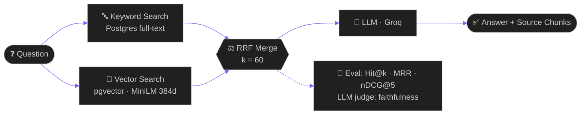

```mermaid
%%{init: {'theme':'dark','themeVariables':{'primaryColor':'#0f1a2e','primaryTextColor':'#ffffff','primaryBorderColor':'#00f5a0','lineColor':'#8b5cf6','secondaryColor':'#070b14','tertiaryColor':'#070b14','fontFamily':'monospace'}}}%%
flowchart LR
    A["📥 Data & Chunking<br/>15 chunking strategies<br/>Loaders · Pandas"] --> B["🧮 Embeddings<br/>Sentence-Transformers<br/>MiniLM-L6-v2"]
    B --> C["🔎 Retrieval<br/>pgvector · FAISS<br/>Hybrid + RRF"]
    C --> D["🤖 LLM Layer<br/>Groq · Gemini · OpenAI<br/>Transformers · Fine-tuning"]
    D --> E["🕸️ Agents & MCP<br/>LangChain · FastMCP<br/>Tool Routing · RBAC"]
    E --> F["🧪 Eval & Security<br/>Hit@k · MRR · nDCG<br/>Red-team · OWASP"]
    F --> G["🚀 Ship<br/>FastAPI · Docker<br/>GitHub Actions · Render"]
```

<div align="center">

<!-- ═══════════════ HEADER ═══════════════ -->


<br/>


<br/><br/>

<a href="https://sourabhbagda24.github.io/portfolio/"></a>
<a href="https://www.linkedin.com/in/sourabh-sharma-90758232b/"></a>
<a href="mailto:sourabhbagda9@gmail.com"></a>
<a href="https://github.com/sourabhbagda24"></a>
<a href="https://www.hackerrank.com/profile/sourabhbagda11"></a>

</div>


<!-- ═══════════════ MODEL CARD ═══════════════ -->
<div align="center">

</div>

```yaml
---
model_name:     sourabh-sharma-v1
model_type:     AI & ML Engineer · Generative AI Engineer
base_training:  B.Tech — VIT Jaipur
location:       Jaipur, Rajasthan 🇮🇳
languages:      [Python, SQL, TypeScript, Hinglish 🗣️]
specialization:
  - RAG systems with hybrid retrieval (keyword + vector + RRF)
  - RAG evaluation (Hit@k, MRR, nDCG, LLM-as-judge)
  - LLM agents, MCP servers & capability-based tool routing
  - Transformers & LLM fine-tuning
  - AI security & red-teaming (OWASP LLM Top 10)
  - Real-time voice AI (WebRTC)
intended_use:   Building AI that thinks, and code that ships ⚡
status:         open-to-work ✅
---
```


<!-- ═══════════════ ABOUT ═══════════════ -->
<div align="center">

</div>


```python
class SourabhSharma:

    name       = "Sourabh Sharma"
    alias      = "sourabhbagda24"
    location   = "Jaipur, Rajasthan 🇮🇳"
    role       = "AI & ML Engineer · Generative AI Engineer"
    current    = "Intern @ ReGex Software 🏢"
    education  = "B.Tech — VIT Jaipur"
    cert       = ["Kaggle Python ✅"]

    ai_stack   = [
        "Transformers & Hugging Face 🤗",
        "LLM Fine-tuning & Prompt Engineering ✍️",
        "RAG Systems & RAG Evaluation 📦",
        "LangChain · LlamaIndex · LangServe 🔗",
        "LLMs — GPT, Gemini, Groq, Ollama 🤖",
        "Agentic AI · MCP · Tool Routing 🕸️",
        "AI Security — OWASP LLM Top 10 🔐",
    ]

    ml_stack   = [
        "Python · Pandas · NumPy · Scikit-Learn 🐍",
        "TensorFlow · Keras · PyTorch 🔥",
        "NLP · RNN · LSTM · CNN 🧠",
        "SQL · MySQL · PostgreSQL · Redis 🗃️",
        "Power BI · Tableau · Plotly 📊",
    ]

    passions   = [
        "Generative AI 🧬",
        "Trading Analytics 📈",
        "Startup & Automation 🚀",
        "NLP & Deep Learning 🧠",
        "Open Source Contribution 🌍",
    ]

    def life_motto(self):
        return "Build AI that thinks. Write code that ships. 🤖⚡"
```

<br clear="right"/>


<!-- ═══════════════ LEADERBOARD ═══════════════ -->
<div align="center">


<br/>

| 🧪 Benchmark | 📊 Result | 🔗 Where |
|:--|:-:|:-:|
| Red-team: 20 attacks on insecure baseline | `19 / 20 succeed` | [secure_ai_gateway](https://github.com/sourabhbagda24/secure_ai_gateway) |
| Red-team: same 20 attacks on the gateway | `0 / 20 succeed` 🛡️ | [secure_ai_gateway](https://github.com/sourabhbagda24/secure_ai_gateway) |
| Automated tests | `273 tests` | [secure-ai-gateway](https://github.com/sourabhbagda24/secure-ai-gateway) |
| Mutation testing of defences | `46 / 46 caught` | [secure_ai_gateway](https://github.com/sourabhbagda24/secure_ai_gateway) |
| Retrieval eval — keyword vs vector vs hybrid (RRF) | `Hit@k · MRR · nDCG@5` | [NEXUS_AI](https://github.com/sourabhbagda24/NEXUS_AI) |
| Answer eval — LLM judge | `Faithfulness · Correctness (1–5)` | [NEXUS_AI](https://github.com/sourabhbagda24/NEXUS_AI) |
| Voice AI in Hinglish over WebRTC | `Real-time` 🗣️ | [Hinglish-AI-Receptionist](https://github.com/sourabhbagda24/Hinglish-AI-Receptionist-main) |

</div>


<!-- ═══════════════ STACK MAP ═══════════════ -->
<div align="center">

</div>




<!-- ═══════════════ CURRENT WORK ═══════════════ -->
<div align="center">

</div>

```bash
╔══════════════════════════════════════════════════════════╗
║  sourabh@ai-lab:~$ cat active_projects.log               ║
╠══════════════════════════════════════════════════════════╣
║  [✦] Internship @ ReGex Software                         ║
║  [✦] LLM Fine-tuning & Transformers                      ║
║  [✦] RAG Evaluation — Hit@k · MRR · nDCG · LLM-judge     ║
║  [✦] Agents, MCP & Tool Routing (LangChain · FastMCP)    ║
║  [✦] AI Chatbot with RAG (LangChain + FAISS + OpenAI)    ║
║  [✦] Trading AI / Quantitative Bot (Python + TA-Lib)     ║
║  [✦] Advanced Python — OOP & Data Structures             ║
║  [✦] SQL Mastery — World DB & Employee DB                ║
║  [✦] AI Crash Course for Startup teams                   ║
║  sourabh@ai-lab:~$ █                                     ║
╚══════════════════════════════════════════════════════════╝
```


<!-- ═══════════════ SKILLS ═══════════════ -->
<div align="center">


<br/>


<br/>


</div>

<br/>

<table align="center">
<tr>
<td valign="top" width="50%">

#### 🧬 &nbsp;Generative AI & LLMs


#### 📦 &nbsp;RAG & Retrieval


#### 🕸️ &nbsp;Agents & Orchestration


#### 🗣️ &nbsp;Voice AI


#### 🔐 &nbsp;AI Security & Testing


</td>
<td valign="top" width="50%">

#### 🧠 &nbsp;ML / DL / NLP


#### 💻 &nbsp;Languages


#### 🌐 &nbsp;Backend & Web


#### 🗃️ &nbsp;Databases


#### 📊 &nbsp;Data Tools


#### 📈 &nbsp;Visualization


#### ☁️ &nbsp;MLOps, Cloud & DevOps


</td>
</tr>
</table>


<!-- ═══════════════ FLAGSHIP PROJECTS ═══════════════ -->
<div align="center">

</div>

<br/>

<table>
<tr>
<td width="50%" valign="top">

### 🧠 &nbsp;[NEXUS AI — Document Intelligence](https://github.com/sourabhbagda24/NEXUS_AI)
**Grounded chat over your documents, with hybrid retrieval and a real evaluation harness.**

Upload PDFs, ask questions, see the source chunks the answer came from.

- 🔎 **Hybrid retrieval:** Postgres full-text + **pgvector**, merged with **RRF (k=60)**
- 🧮 Local embeddings with `all-MiniLM-L6-v2` (384-dim) via `@huggingface/transformers`
- 📏 **RAG evaluation:** Hit@k, MRR, nDCG@5, off-topic rejection, LLM-judge faithfulness & correctness
- 🎙️ Voice surface, source preview, streaming chat, FastAPI backend seam
- 🧪 Compares keyword vs vector vs hybrid on your own documents

`RAG` `pgvector` `Hybrid Search` `RAG Evaluation` `Groq` `TypeScript` `React`

</td>
<td width="50%" valign="top">

### 🔐 &nbsp;[Secure AI Gateway](https://github.com/sourabhbagda24/secure_ai_gateway)
**Security at every layer for LLM / RAG / agent apps, as working, tested code.**

Turns the OWASP LLM Top 10 checklist into a runnable defence pipeline, then proves it with a red-team suite.

```text
Attacks that worked on insecure baseline : 19/20
Attacks that worked on secure gateway    :  0/20
```

- 🛡️ Prompt-injection detection · PII/secret redaction · RAG tenant isolation
- 🧑‍⚖️ Least-privilege roles, tool allowlist, **human approval** for risky actions
- 🧪 273 tests · **46 defences mutation-tested**, all 46 caught
- ⚙️ GitHub Actions CI · Dockerfile · Render deploy · Groq & Anthropic adapters

`Python` `OWASP LLM Top 10` `Pytest` `Docker` `Red Teaming`

</td>
</tr>
<tr>
<td width="50%" valign="top">

### 🗣️ &nbsp;[Hinglish AI Receptionist](https://github.com/sourabhbagda24/Hinglish-AI-Receptionist-main)
**Browser-first voice receptionist that talks in Hinglish, built for Beyond Tech Intelligence.**

Speak in the browser, the AI answers back in real time over WebRTC.

- 🎙️ Pipecat WebRTC voice pipeline · Groq LLM · Cartesia speech
- ⚡ React + Vite frontend, FastAPI backend, PostgreSQL storage
- 🚀 3-service Render blueprint (frontend, API, voice bot) with Dockerfiles
- 🔎 SEO / AEO / GEO ready: JSON-LD, `sitemap.xml`, `llms.txt`

`React` `Vite` `TypeScript` `FastAPI` `Pipecat` `Groq` `Cartesia` `PostgreSQL`

</td>
<td width="50%" valign="top">

### 🎧 &nbsp;[Mectro AI Customer Support](https://github.com/sourabhbagda24/Mectro-AI-Customer-Support)
**Three single-responsibility LangChain agents that answer support tickets from a real database.**

```text
Message → Intent Agent → MySQL Lookup Agent → Reply Agent
```

- 🤖 Detects intent (refund, order status, shipping...), fetches real data, writes the reply
- 🛡️ Parameterised SQL via SQLAlchemy, no raw SQL from the LLM
- 🔌 Same 5 tools exposed as an **MCP server** (FastMCP)
- ⚡ Groq LLM · Pydantic structured output · FastAPI endpoint

`LangChain Agents` `Groq` `MySQL` `FastAPI` `FastMCP` `Pydantic`

</td>
</tr>
<tr>
<td width="50%" valign="top">

### 🧩 &nbsp;[MCP Order Management — RBAC](https://github.com/sourabhbagda24/mcp-order-management-rbac)
**Access control enforced inside the MCP server, not the client.**

```text
Client → FastAPI (JWT auth) → MCP Server (RBAC) → MySQL
```

- 👥 Roles: USER, MANAGER, ADMIN with per-action permission matrix
- 🔐 FastAPI only authenticates, every authorization decision lives in the MCP tools
- 🗃️ MySQL schema + seed data included

`MCP` `RBAC` `JWT` `FastAPI` `MySQL`

</td>
<td width="50%" valign="top">

### 🧭 &nbsp;[Capability-Based Tool Routing](https://github.com/sourabhbagda24/capability-based-tool-routing)
**An LLM router that picks tools by capability, then filters them by permission.**

```text
Query → Gemini Router → Capabilities → Tool Registry → Permission Manager → Allowed Tools
```

- 🔎 Handles multiple capabilities per query
- 🧱 Add new tools without touching routing logic
- 🔑 Public / User / Admin permission levels
- 🗂️ Companion: [dynamic-ai-tool-registry](https://github.com/sourabhbagda24/dynamic-ai-tool-registry) (thread-safe, enable/disable, discovery)

`Gemini` `Tool Routing` `Registry` `Permissions`

</td>
</tr>
</table>

#### 🔁 &nbsp;NEXUS AI — Hybrid Retrieval Flow



#### 🔁 &nbsp;Secure AI Gateway — Request Flow

```mermaid
%%{init: {'theme':'dark','themeVariables':{'primaryColor':'#0f1a2e','primaryTextColor':'#ffffff','primaryBorderColor':'#00f5a0','lineColor':'#8b5cf6','secondaryColor':'#070b14','tertiaryColor':'#070b14','fontFamily':'monospace'}}}%%
flowchart LR
    U([👤 User]) --> A[Auth + AuthZ]
    A --> R[Rate Limit<br/>Token Budget]
    R --> I[Input Validation<br/>Injection Detector]
    I --> P[PII / Secret<br/>Minimisation]
    P --> O{{Orchestrator}}
    O --> T[RAG / Tools<br/>Human Approval]
    T --> L[(LLM)]
    L --> V[Output Validation<br/>PII Filter]
    V --> G[Audit Log]
    G --> X([✅ Response])
```




<!-- ═══════════════ MORE PROJECTS ═══════════════ -->
<div align="center">

</div>

#### 🕸️ &nbsp;Agents, MCP & LLM Apps

| 🚀 Project | 📝 What it does | 🛠️ Tech |
|:--|:--|:-:|
| [**AI Meeting Minutes Generator**](https://github.com/sourabhbagda24/AI-Meeting-Minutes-Generator) | 5 specialised agents turn a raw transcript into Minutes of Meeting: summary, decisions, action items, deadlines, outcomes | `Streamlit` `Agents` `Pydantic` |
| [**LangChain Agent with Tools**](https://github.com/sourabhbagda24/LangChain-Agent-with-Tools) | Tool-calling agent that decides when to use a calculator or word counter vs answer directly | `LangChain` `Gemini` `Streamlit` |
| [**LangServe with Gemini & Groq**](https://github.com/sourabhbagda24/LangServe-with-Gemini-Groq) | Two LLMs exposed as REST endpoints with LangServe, plus a client | `FastAPI` `LangServe` `Groq` |
| [**Redis Chat Memory**](https://github.com/sourabhbagda24/Redis-chat-memory) | Short-term chatbot memory in Redis lists with auto-expiring TTL | `Redis` `Python` |
| [**AI Business Report Generator Agent**](https://github.com/sourabhbagda24/AI_BUSINESS_REPORT_GENRATOR_AGENT) | Agent that generates business reports | `Agents` `LLM` |
| [**n8n Workflows**](https://github.com/sourabhbagda24/n8n_workflows) | Automation workflows | `n8n` `Python` |

#### 📦 &nbsp;RAG, Embeddings & NLP

| 🚀 Project | 📝 What it does | 🛠️ Tech |
|:--|:--|:-:|
| [**All Chunking Strategies**](https://github.com/sourabhbagda24/ALL_CHUNKING_STRATGIES) | 15 text chunking techniques for RAG pipelines: fixed, sliding window, sentence, recursive and more | `NLTK` `LangChain` |
| [**Semantic Search from Scratch**](https://github.com/sourabhbagda24/SEMANTIC_SEARCH_PROJECT) | Top-K retrieval with MiniLM embeddings and hand-written cosine similarity, no vector DB, no LLM | `Sentence-Transformers` `NumPy` |
| [**Embeddings with LangChain**](https://github.com/sourabhbagda24/EMBEDDING_LANGCHAIN) | Embedding workflows with LangChain | `LangChain` `Embeddings` |
| [**Data Loaders with LangChain**](https://github.com/sourabhbagda24/DATA_LOADERS_WITH_LANGCHAIN) | Loading documents from different sources into LangChain | `LangChain` `Jupyter` |
| [**Aspect-Based Sentiment Analysis**](https://github.com/sourabhbagda24/Aspect-Based-Sentiment-Analysis-NLP) | Extracts features, opinions and sentiment from reviews as structured JSON, zero API cost | `NLTK` `Python` |
| [**Resume Analytics Platform**](https://github.com/sourabhbagda24/Resume_analytics_platform) | Fetches resumes from Google Drive and parses education, experience and skills with NLP | `spaCy` `Drive API` |
| [**Guardinals — PII Masking**](https://github.com/sourabhbagda24/Gaurdinals) | Redacts 10+ PII types, tailored for Indian data: Aadhaar, PAN, IFSC, cards, phones | `Python` `Regex` |
| [**TF-IDF + Logistic Regression Pipeline**](https://github.com/sourabhbagda24/TFIDF-Logistic-Regression-Classifier-Pipeline) | Classical text classification pipeline | `Scikit-Learn` |

#### 🧠 &nbsp;Deep Learning & ML

| 🚀 Project | 📝 What it does | 🛠️ Tech |
|:--|:--|:-:|
| [**Chest X-Ray Classifier**](https://github.com/sourabhbagda24/Chest-Xray-Classifier) | End-to-end MLOps: transfer-learning CNN, DVC pipeline, Flask API, Docker, AWS, CI/CD | `TensorFlow` `DVC` `Docker` `AWS` |
| [**DL Optimizers from Scratch**](https://github.com/sourabhbagda24/DL_OPTIMIZERS) | SGD, Momentum, NAG, Adagrad, RMSprop and Adam written by hand in NumPy | `NumPy` |
| [**LSTM — IMDb Sentiment**](https://github.com/sourabhbagda24/LSTM) | Sentiment classification with an LSTM | `TensorFlow` `Keras` |
| [**RNN Architecture — IMDb**](https://github.com/sourabhbagda24/RNN_ARCHITECTURE) | Simple RNN sentiment model | `TensorFlow` `Keras` |
| [**Employee Attrition ANN**](https://github.com/sourabhbagda24/Employee-attrition-neural-network) | Neural network predicting whether an employee will leave | `Keras` `Scikit-Learn` |
| [**Auto ML Pipeline**](https://github.com/sourabhbagda24/auto-ml-pipeline) | CSV to saved model in 11 steps: cleaning, SMOTE, 13+ models, GridSearchCV | `Scikit-Learn` |
| **Classical ML** | [KNN](https://github.com/sourabhbagda24/KNN_MODEL) · [SVM](https://github.com/sourabhbagda24/SVM_Model) · [Random Forest](https://github.com/sourabhbagda24/Random_forest_regressor) · [K-Means](https://github.com/sourabhbagda24/k-means-unsupervised-model-) · [PCA](https://github.com/sourabhbagda24/PCA_unsupervised-ml-model) | `Scikit-Learn` |

#### 🌐 &nbsp;Full-Stack & Backend

| 🚀 Project | 📝 What it does | 🛠️ Tech |
|:--|:--|:-:|
| [**VyapaarSetu**](https://github.com/sourabhbagda24/VYAPAARSETU) | Order orchestration engine and storefront for a D2C seller: Razorpay, WhatsApp/Instagram webhooks, idempotent job queue with retries and dead-letter queue, admin RBAC | `FastAPI` `React` `MySQL` |
| [**DS Interview Vault**](https://github.com/sourabhbagda24/ds-interview-vault) | Searchable interview question bank by company, role and year | `Flask` `JavaScript` |
| [**Data Science Learning**](https://github.com/sourabhbagda24/Data__Science__Learning) | Notebooks across the data science workflow: analysis, visualization, ML | `Python` `Jupyter` |


<!-- ═══════════════ WORKFLOW ═══════════════ -->
<div align="center">

</div>

```python
# 🧪 How I build an AI system
pipeline = [
    "01 · Understand  →  user problem, success metric",
    "02 · Prepare      →  clean data, chunking strategy, embeddings",
    "03 · Retrieve     →  keyword + vector + RRF (hybrid search)",
    "04 · Generate     →  prompt engineering, fine-tuning, tool calling",
    "05 · Evaluate     →  Hit@k, MRR, nDCG, LLM-judge faithfulness",
    "06 · Secure       →  injection defence, PII redaction, red-team",
    "07 · Ship         →  FastAPI · Docker · CI/CD · Render",
]

for step in pipeline:
    print(step)
```


<!-- ═══════════════ ROADMAP ═══════════════ -->
<div align="center">


<br/>

<table>
<tr>
<td width="50%" valign="top">

**🧬 MISSION 01 — Generative AI & Agentic Systems**

| Topic | Status |
|:--|:-:|
| LLMs — Fine-tuning, Prompt Engineering | 🔄 In Progress |
| Transformers — architecture & Hugging Face | 🔄 In Progress |
| RAG Systems & Vector Databases | ✅ Built |
| RAG Evaluation (Hit@k, MRR, LLM-judge) | ✅ Built |
| Agentic AI, MCP & Tool Routing | 🔄 In Progress |
| Stable Diffusion & Multimodal AI | ⏳ Queued |

**🧠 MISSION 02 — Deep Learning & Advanced NLP**

| Topic | Status |
|:--|:-:|
| CNN, RNN, LSTM | ✅ Built |
| Transformers from Scratch | ⏳ Queued |
| Computer Vision — YOLO, SAM | ⏳ Queued |

</td>
<td width="50%" valign="top">

**🚢 MISSION 03 — MLOps & Deployment**

| Topic | Status |
|:--|:-:|
| Docker & Containerization | ✅ Built |
| CI/CD with GitHub Actions | ✅ Built |
| FastAPI + Model Serving | ✅ Built |
| DVC & ML Pipelines | 🔄 In Progress |

**🔐 MISSION 04 — AI Security**

| Topic | Status |
|:--|:-:|
| OWASP LLM Top 10 Defences | ✅ Built |
| Red-Team Evaluation Suites | ✅ Built |
| Guardrails for Agents & Tools | 🔄 In Progress |

**📈 MISSION 05 — Trading AI & Quant Systems**

| Topic | Status |
|:--|:-:|
| Algorithmic Trading & Backtesting | 🔄 In Progress |
| Reinforcement Learning for Trading | ⏳ Queued |

</td>
</tr>
</table>


</div>


<!-- ═══════════════ STATS ═══════════════ -->
<div align="center">


<br/>


&nbsp;


<br/>


<br/>


<br/>


</div>


<!-- ═══════════════ GAMES & ANIMATIONS ═══════════════ -->
<div align="center">


<sub>🕹️ &nbsp;All animations are live and auto-updating via GitHub Actions</sub>

<br/><br/>

**🐍 &nbsp;Snake Eats My Contributions**

<picture>
  <source media="(prefers-color-scheme: dark)" srcset="https://raw.githubusercontent.com/sourabhbagda24/sourabhbagda24/output/github-snake-dark.svg"/>
  <source media="(prefers-color-scheme: light)" srcset="https://raw.githubusercontent.com/sourabhbagda24/sourabhbagda24/output/github-snake.svg"/>
  
</picture>

<br/>

**👻 &nbsp;Pac-Man Eats My Contributions**

<picture>
  <source media="(prefers-color-scheme: dark)" srcset="https://raw.githubusercontent.com/sourabhbagda24/sourabhbagda24/output/pacman-dark.svg"/>
  <source media="(prefers-color-scheme: light)" srcset="https://raw.githubusercontent.com/sourabhbagda24/sourabhbagda24/output/pacman.svg"/>
  
</picture>

</div>

<br/>

<div align="center">

### 🧠 &nbsp;AI Engineer — Character Stats
<sub>Level 38 &nbsp;·&nbsp; Class: AI & ML Engineer · GenAI Engineer &nbsp;·&nbsp; Guild: VIT Jaipur</sub>

</div>

```text
 🐍 Python            ▰▰▰▰▰▰▰▰▰▰▰▰▰▰▰▰▰▰▱▱  92/100  ★★★★★
 📊 Data Analysis     ▰▰▰▰▰▰▰▰▰▰▰▰▰▰▰▰▰▰▱▱  88/100  ★★★★★
 🤖 AI / LLM Dev      ▰▰▰▰▰▰▰▰▰▰▰▰▰▰▰▰▱▱▱▱  80/100  ★★★★☆
 🗃️ SQL               ▰▰▰▰▰▰▰▰▰▰▰▰▰▰▰▰▱▱▱▱  80/100  ★★★★☆
 🔗 LangChain / RAG   ▰▰▰▰▰▰▰▰▰▰▰▰▰▰▰▰▱▱▱▱  80/100  ★★★★☆
 📏 RAG Evaluation    ▰▰▰▰▰▰▰▰▰▰▰▰▰▰▰▱▱▱▱▱  75/100  ★★★★☆
 📈 Power BI          ▰▰▰▰▰▰▰▰▰▰▰▰▰▰▱▱▱▱▱▱  72/100  ★★★★☆
 🧠 NLP / Transf.     ▰▰▰▰▰▰▰▰▰▰▰▰▰▰▱▱▱▱▱▱  70/100  ★★★★☆
 🤗 Transformers      ▰▰▰▰▰▰▰▰▰▰▰▰▰▰▱▱▱▱▱▱  70/100  ★★★★☆
 🔥 PyTorch           ▰▰▰▰▰▰▰▰▰▰▰▰▰▱▱▱▱▱▱▱  65/100  ★★★☆☆
 🎛️ LLM Fine-tuning   ▰▰▰▰▰▰▰▰▰▰▰▰▱▱▱▱▱▱▱▱  60/100  ★★★☆☆
 ☁️ AWS / GCP         ▰▰▰▰▰▰▰▰▰▰▰▰▱▱▱▱▱▱▱▱  60/100  ★★★☆☆
 🐳 Docker / MLOps    ▰▰▰▰▰▰▰▰▰▰▰▰▰▱▱▱▱▱▱▱  65/100  ★★★☆☆

 🏅 SPECIAL SKILLS
 🕸️ Agentic AI / MCP    ▰▰▰▰▰▰▰▰▰▰▰▰▰▰▰▱▱▱▱▱  ★★★★☆
 📈 Trading Analytics   ▰▰▰▰▰▰▰▰▰▰▰▰▰▰▰▰▱▱▱▱  ★★★★☆
 🔐 AI Security (OWASP) ▰▰▰▰▰▰▰▰▰▰▰▰▰▰▰▰▱▱▱▱  ★★★★☆
 ✍️ Prompt Engineering  ▰▰▰▰▰▰▰▰▰▰▰▰▰▰▰▰▰▰▰▰  ★★★★★
 🧩 Problem Solving     ▰▰▰▰▰▰▰▰▰▰▰▰▰▰▰▰▰▰▰▰  ★★★★★
```

<div align="center">

<br/>

**🎯 &nbsp;Wakatime Coding Activity**

<!--START_SECTION:waka-->
```text
Python       █████████████████░░░░   58.4%
SQL          ████████░░░░░░░░░░░░░   22.1%
Jupyter      ████░░░░░░░░░░░░░░░░░   10.3%
Markdown     ██░░░░░░░░░░░░░░░░░░░    6.2%
Shell        █░░░░░░░░░░░░░░░░░░░░    3.0%
```
<!--END_SECTION:waka-->

<br/>

**🎲 &nbsp;Random Dev Joke**


<br/>

**💬 &nbsp;Random Motivational Quote**

<a href="https://github.com/piyushsuthar/github-readme-quotes">
  
</a>

<br/><br/>

**🌍 &nbsp;Profile Visitor Counter**


<br/><br/>

**🐱 &nbsp;Coding Cats**


&nbsp;&nbsp;

&nbsp;&nbsp;


</div>


<!-- ═══════════════ PORTFOLIO ═══════════════ -->
<div align="center">


<br/>

#### 🌌 &nbsp;My 3D AI-Powered Portfolio Website

`✦ Three.js 3D Rotating Data Sphere` &nbsp; `✦ Neon Particle Background`
`✦ Interactive AI Project Cards with 3D Tilt` &nbsp; `✦ Cyberpunk Dark + Neon Blue Theme`
`✦ Fully Responsive — Mobile & Desktop`

<br/>

<a href="https://sourabhbagda24.github.io/portfolio/">
  
</a>

</div>


<!-- ═══════════════ PROFILES ═══════════════ -->
<div align="center">


<br/>

<a href="https://www.hackerrank.com/profile/sourabhbagda11"></a>
<a href="https://www.kaggle.com/"></a>
<a href="https://www.linkedin.com/in/sourabh-sharma-90758232b/"></a>

</div>


<!-- ═══════════════ CONNECT ═══════════════ -->
<div align="center">


<br/>

<a href="https://www.linkedin.com/in/sourabh-sharma-90758232b/"></a>
<a href="mailto:sourabhbagda9@gmail.com"></a>
<a href="https://github.com/sourabhbagda24"></a>
<a href="https://www.kaggle.com/"></a>
<a href="https://www.hackerrank.com/profile/sourabhbagda11"></a>

<br/><br/>


<br/>

*Stay curious. Keep building. Ship AI.*


</div>
